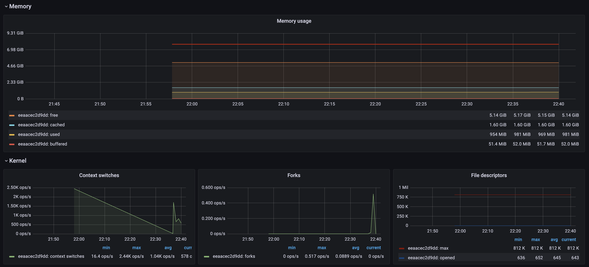
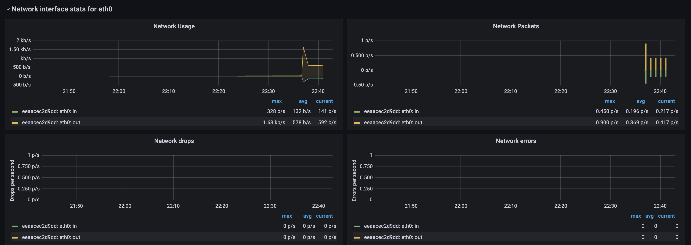
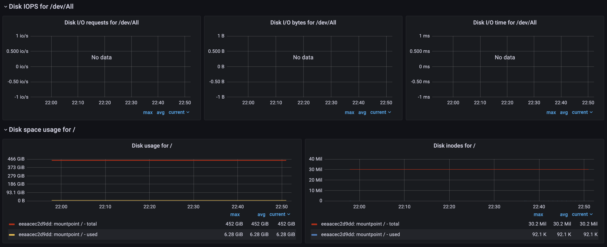
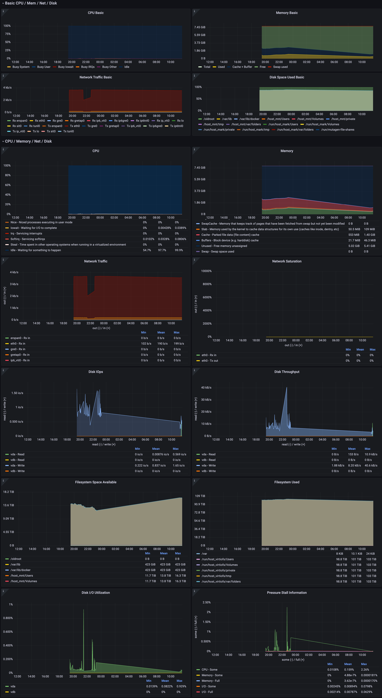
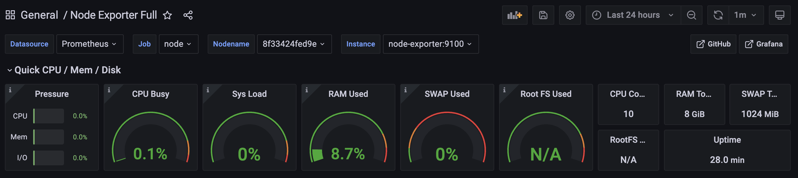
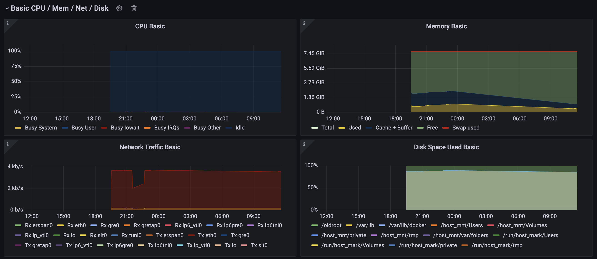

# Домашнее задание к лекции 2 «Подготовка стенда нагрузочного тестирования»

## Отчет о развертывании системы мониторинга на основе Telegraf + InfluxDB + Grafana

**Сделано:**
1. Клонирован репозиторий с заготовками.
2. В файл `docker-compose.yml` добавлена строка `platform: linux/x86_64` для корректной работы на процессоре Apple Silicon (M5). Удалена устаревшая строка `version`.
3. В конфигурационном файле `telegraf.conf` установлен интервал отправки метрик `interval = "60s"`.
4. Добавлены плагины для сбора аппаратных метрик: `[[inputs.mem]]`, `[[inputs.swap]]`, `[[inputs.disk]]`, `[[inputs.net]]`.
5. Запущены контейнеры командой `docker compose -f telegraf/docker-compose.yml up -d`.
6. В Grafana (localhost:3000) настроен Data Source (InfluxDB) и импортирован дашборд (ID: 928).
7. Сделаны скриншоты состояния метрик в покое (длительность 15+ минут).

**Скриншоты Telegraf:**

---

## Отчет о развертывании системы мониторинга на основе Node Exporter + Prometheus + Grafana

**Сделано:**
1. В файл `docker-compose.yml` добавлена строка `platform: linux/x86_64` для работы на Apple Silicon (M5). Удалена строка `version`.
2. В файле `prometheus.yml` установлен интервал опроса (scrape) в 36 секунд: `scrape_interval: 36s`.
3. Для избежания конфликта портов, Grafana для Prometheus развернута на порту **3001** (`localhost:3001`).
4. Запущены контейнеры командой `docker compose -f prometheus/docker-compose.yml up -d`.
5. В Grafana (localhost:3001) настроен Data Source (Prometheus) и импортирован официальный дашборд Node Exporter Full (ID: 1860).
6. Сделан скриншот интерфейса Grafana с метриками системы в покое (длительность 15+ минут).

**Скриншоты Prometheus:**

